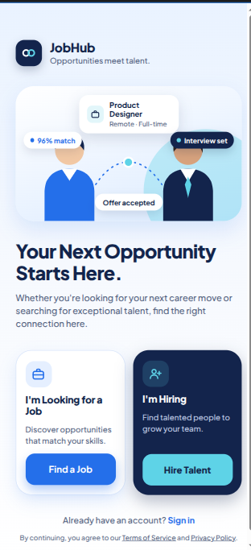
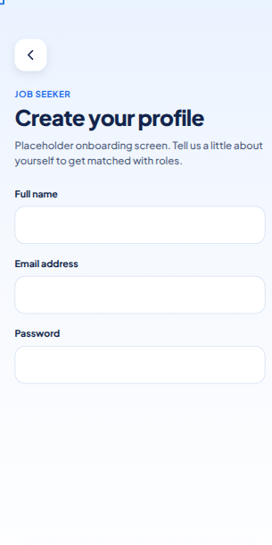
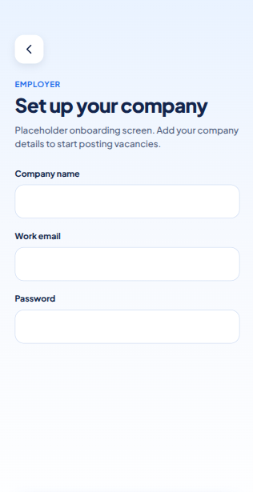
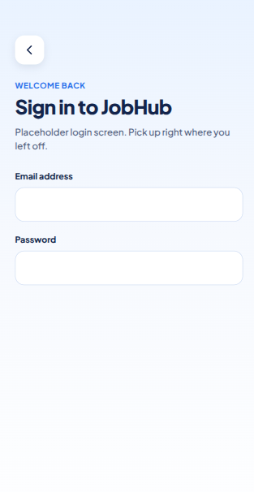

# JobHub – Project Proposal

## 1. Title and one-sentence description

**JobHub – Mobile Job Search and Recruitment Platform**

An app that helps job seekers discover and apply for suitable job opportunities and employers find and recruit qualified candidates so that the job-search and recruitment process becomes easier, faster and more accessible.

## 2. Group

| Name            | Role                      |
| --------------- | ------------------------- |
| Samuel Asmare   | Team lead and integration |
| Melkamu Tsegaye | Flutter UI and navigation |
| Yadelew Zemene  | Backend and REST API      |
| Natnael Tigistu | Firebase and testing      |

## 3. The problem

Finding employment and recruiting suitable candidates can be difficult and time-consuming. Job seekers often discover vacancies through social media posts, personal connections and different websites. These opportunities are scattered, making it difficult to find relevant jobs, understand application requirements and track submitted applications. Employers also struggle to reach suitable candidates and manage applications received through different channels.

JobHub addresses these challenges by providing a centralized mobile platform where job seekers can discover opportunities, create profiles, submit applications and communicate with employers. Employers can publish vacancies, review applications, identify suitable candidates and manage recruitment activities from one platform.

A mobile application is appropriate because job seekers and employers can access the platform from their smartphones, receive notifications and communicate without depending on a desktop computer.

**Potential user validation:** [Insert the name of one real job seeker or employer interviewed by the group and briefly describe the difficulty they experienced and what the group learned. This must be completed before submission.]

## 4. Users

**1. Job seekers**

People looking for employment, including graduates, students and experienced professionals. They need to discover relevant vacancies, manage their profiles, submit applications and communicate with employers. They may use the application several times a week or daily.

**2. Employers / Recruiters**

Companies and individuals looking for qualified employees. They need to publish job vacancies, review candidate profiles, manage applications and communicate with potential employees. They may use the application several times a week, especially during recruitment periods.

## 5. User stories

| ID  | User story                                                                                                                                                   | Priority   |
| --- | ------------------------------------------------------------------------------------------------------------------------------------------------------------ | ---------- |
| US1 | As a user, I want to register, log in and manage my profile so that I can access the platform according to my role.                                          | **Must**   |
| US2 | As a job seeker, I want to search, filter and find nearby jobs so that I can discover suitable opportunities.                                                | **Must**   |
| US3 | As a job seeker, I want to view job details and receive an AI-generated summary so that I can understand job requirements before applying.                   | **Should** |
| US4 | As a job seeker, I want to submit my CV and apply for jobs so that employers can consider my qualifications.                                                 | **Must**   |
| US5 | As an employer, I want to create, edit and delete job vacancies so that I can manage recruitment opportunities.                                              | **Must**   |
| US6 | As an employer, I want to view applicants and update their application statuses so that I can manage the recruitment process.                                | **Must**   |
| US7 | As a job seeker, I want to save jobs and receive application status notifications so that I can keep track of interesting opportunities and my applications. | **Should** |
| US8 | As a job seeker or employer, I want to communicate through real-time messaging so that I can discuss job opportunities and applications.                     | **Could**  |

## 6. Screens

| Screen               | Purpose                                                                                                                                             | User stories |
| -------------------- | --------------------------------------------------------------------------------------------------------------------------------------------------- | ------------ |
| Welcome              | Introduces JobHub and provides access to registration and login.                                                                                    | US1          |
| Login / Registration | Authenticates users and allows role selection.                                                                                                      | US1          |
| Job Seeker Home      | Displays recent and recommended vacancies.                                                                                                          | US2          |
| Job Search           | Searches and filters available jobs, including nearby opportunities.                                                                                | US2          |
| Job Details          | Displays job descriptions, requirements and AI summaries.                                                                                           | US2, US3     |
| Job Seeker Profile   | Allows users to manage personal information and qualifications.                                                                                     | US1          |
| My CV                | Allows job seekers to upload their CV once, view it and replace it when necessary. The saved CV is automatically attached to every job application. | US4          |
| Apply for Job        | Automatically attaches the job seeker's saved CV and requires a separate cover letter for the selected job before submission.                       | US4          |
| My Applications      | Displays submitted applications and their statuses.                                                                                                 | US4, US7     |
| Saved Jobs           | Displays bookmarked job opportunities.                                                                                                              | US7          |
| Employer Dashboard   | Displays recruitment statistics and a list of the employer's vacancies.                                                                             | US5, US6     |
| Vacancy Details      | Displays a selected vacancy and provides options to edit or delete it.                                                                              | US5          |
| Post / Edit Vacancy  | Allows employers to create new vacancies or update existing vacancies.                                                                              | US5          |
| Applicants           | Displays candidates and allows employers to update application statuses.                                                                            | US6          |
| Messages             | Supports conversations between job seekers and employers.                                                                                           | US8          |
| Notifications        | Displays application updates and other relevant alerts.                                                                                             | US7          |
| Settings             | Allows users to manage account and application preferences.                                                                                         | US1          |

### Four main screen sketches

**A. Welcome**

**B. Sign Up**

**C. Register Company**

**D. Login to exising profile**

## 7. Data model

**User:** id, name, email, password/authUid, role, phone, profileImage.

**JobSeekerProfile:** id, userId, skills, education, experience, location, cv.

**EmployerProfile:** id, userId, companyName, description, address, logo.

**Job:** id, employerId, title, description, requirements, category, location, salary, employmentType, createdAt, status.

**Application:** id, jobId, jobSeekerId, cvUrl, coverLetter, status, appliedAt.

**SavedJob:** id, userId, jobId, savedAt.

**Conversation:** id, jobId, jobSeekerId, employerId, createdAt.

**Message:** id, conversationId, senderId, content, createdAt, isRead.

**Notification:** id, userId, title, message, type, isRead, createdAt.

### Relationships

- A user has one role and can have a job seeker or employer profile.
- An employer can publish multiple jobs.
- A job can receive multiple applications.
- A job seeker can submit multiple applications.
- A job seeker can save multiple jobs.
- A conversation connects a job seeker and an employer.
- A conversation contains multiple messages.
- A user can receive multiple notifications.

## 8. Data sources

**Local persistence – shared_preferences**

Stores user interface preferences, selected filters, theme settings and other small preferences locally on the device.

**REST web service – Backend API**

A REST API will manage job vacancies, job searches, applications, CV metadata and recruitment operations. The backend will communicate with a database to store and retrieve application data.

**Firebase**

- **Firebase Authentication:** Handles user registration, login and authentication.
- **Cloud storage:** Stores user profile information, saved jobs, real-time conversations, messages and notification records.

The application will use authenticated requests and appropriate access controls to protect user information.

## 9. Device feature and AI feature

**Device feature: Location (GPS)**

JobHub will use the device's location to help job seekers discover nearby vacancies.

- User story: US2.
- Device permission: Location permission (`ACCESS_FINE_LOCATION` and `ACCESS_COARSE_LOCATION` on Android).
- Location access will be requested when the user selects the nearby-jobs feature.
- The user can still search jobs manually without granting location permission.

**AI feature: Job description summarization**

JobHub will provide an AI-generated summary of lengthy job descriptions, highlighting responsibilities, required skills and qualifications.

- User story: US3.
- AI service: xAI Grok API, accessed through the backend.
- Data sent: Public job title, description and requirements.
- Recipient: xAI's Grok API service.
- Personal information, passwords and applicant CVs will not be sent to the AI service.
- The application will display the generated summary to the job seeker.

## 10. Risks

| Risk                                                            | Likelihood | Plan                                                                                   |
| --------------------------------------------------------------- | ---------- | -------------------------------------------------------------------------------------- |
| Firebase or REST API integration difficulties                   | Medium     | Develop and test integrations early and divide responsibilities among members.         |
| AI API unavailable or rate limits reached                       | Medium     | Handle errors and display the original job description when summarization fails.       |
| GPS permission denied or location unavailable                   | Medium     | Provide manual location-based search as an alternative.                                |
| Real-time messaging and notifications take longer than expected | High       | Prioritize job searching and applications, then implement messaging and notifications. |
| Members have conflicting schedules, exams or workload           | Medium     | Divide tasks, hold regular progress meetings and use GitHub for collaboration.         |

## 11. Milestone plan

**Milestone 1 – Week 6: UI and navigation**

- US1: Registration, login and role-based navigation screens.
- US2: Job browsing, searching and filtering screens.
- US4: Job application screens.
- US5: Employer dashboard and job management screens.
- US6: Applicant management screens.
- All application screens will be connected through navigation and use in-memory sample data.

**Milestone 2 – Week 10: Real data and core functionality**

- US1: Firebase Authentication and user profiles.
- US2: Real job listings, search, filtering and location-based discovery.
- US4: Real application submission and CV handling.
- US5: Create, edit and delete job vacancies through the REST API.
- US6: Retrieve applications and update application statuses.
- US7: Save jobs and persist application notifications.

**Final Submission – Week 14: Advanced functionality and testing**

- US3: AI-powered job description summarization.
- US7: Application status notifications.
- US8: Real-time messaging between job seekers and employers.
- Complete testing, bug fixing, interface improvements, security checks and documentation.

## 12. AI-use plan

The group intends to use the following AI tools responsibly:

- **ChatGPT:** Understand Flutter and Dart concepts, explain errors, review code and assist with test-case ideas.
- **GitHub Copilot:** Assist with code completion, boilerplate and repetitive programming tasks.
- **AI coding assistance:** Help identify bugs and suggest improvements to application architecture.

All generated code will be reviewed, understood, tested and adapted by group members. Each member will remain responsible for their contributions.
